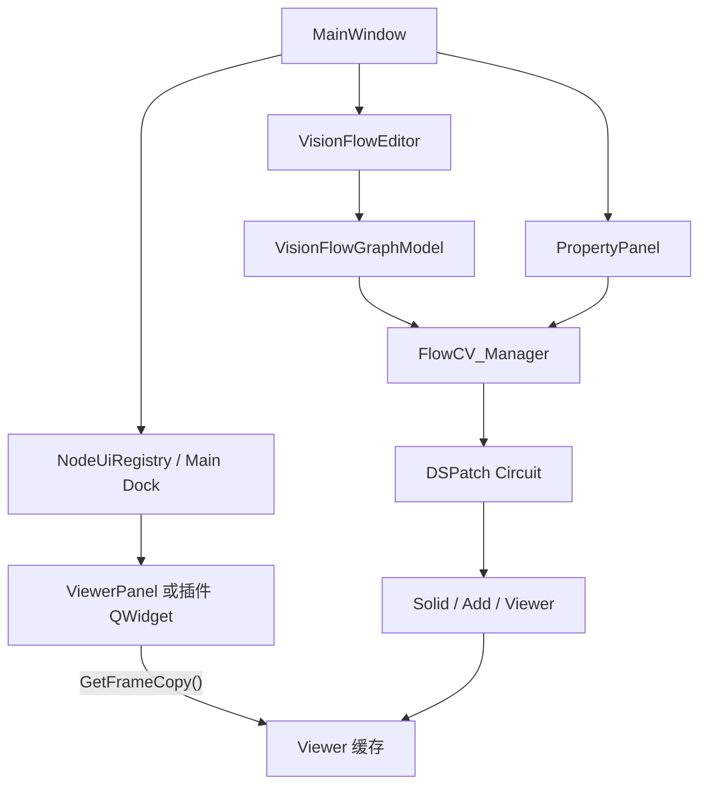

# 项目架构

本文描述当前源码的模块关系、运行路径和接口边界。实现状态与验证依据见 [开发进度](development-status.md)，操作步骤见 [Studio 使用指南](studio-guide.md)，构建环境与依赖来源见 [第三方依赖](../third_party/README.md)。

## 模块职责

| 模块 | 职责与主要入口 |
| --- | --- |
| `Utils` | 日志等公共辅助功能；[logging](../Utils/logging/logger.h) 使用 spdlog |
| `sdk` | [公共类型](../sdk/flowTypes.h)、[属性存储](../sdk/flowProperties.h)、[Node 基类](../sdk/flowNode.h)；内部构建 DSPatch |
| `nodes` | Solid、Add、Blur、Canny、Resize、Viewer 等已接入计算实现；依赖 SDK 与 OpenCV，不创建 Qt 窗口 |
| `managers` | [FlowCV_Manager](../managers/flowcv_manager.h) 管理运行图，[InternalNodeManager](../managers/node_manager.h) 管理内置工厂，[PluginManager](../managers/plugin_manager.h) 管理动态插件 |
| `editor` | [VisionFlowEditor](../editor/VisionFlowEditor.h) 组织画布交互，[VisionFlowGraphModel](../editor/Graph/VisionFlowGraphModel.hpp) 适配运行图，[PropertyPanel](../editor/PropertyPanel.h) 编辑参数；[NodeUi](../editor/NodeUi/NodeUiProvider.h) 定义可选 Qt 界面契约 |
| `app/VisionFlowStudio` | [入口](../app/VisionFlowStudio/main.cpp) 装配应用，[MainWindow](../app/VisionFlowStudio/MainWindow.h) 组织 Dock，[ViewerPanel](../app/VisionFlowStudio/ViewerPanel.h) 显示结果 |
| `plugins`、`tools` | 分别放置 ImageLoader 动态插件与开发辅助工具；加载器位于 Managers |
| `third_party` | 查找外部包并构建 QtNodes；DSPatch 由 `sdk/thirdParty` 管理 |

SDK 不依赖 Managers、Nodes、Editor 或 Qt；计算节点不依赖编辑器。Managers 在构造内置工厂时直接注册具体节点，因此实际依赖 Nodes。Utils 不反向依赖业务模块。无界面入口 `app/ProcessEngine` 尚未接入可执行目标。

## 图交互与计算

QtNodes 处理节点图形、选择、拖动、连线与缩放；计算数据由 DSPatch 的 SignalBus 传递。GraphModel 的 `PortRole::Data` 返回空值，不建立第二套图像传输或计算链路。

[GraphModel](../editor/Graph/VisionFlowGraphModel.cpp) 维护 QtNodes 的 32 位 NodeId 与 Manager 的 64 位节点 ID 映射，位置和尺寸只作为画布状态缓存。节点创建、删除和连线操作调用 Manager，成功后发送 QtNodes 信号更新图形。输入端口最多连接一路，输出允许分发；新连线只接受相同 IoType，Manager 负责输入连接替换和记录同步。`rebuildFromManager()` 可在外部更改运行图后重读节点并通知画布重建，但不负责文件读取或节点位置持久化。

[VisionFlowEditor](../editor/VisionFlowEditor.cpp) 从节点描述生成分类菜单和搜索，转发选择与图变化通知。Cut/Copy/Paste 由项目自己的子图命令实现，使用 `nodes`、`connections`、`editor` 结构；无参数节点也参与复制，粘贴重建 ID、实例编号和内部连接。批量变更用 AutoTickPause 保持此前执行状态，失败仅回滚本次新增对象。QtNodes 原生的 Copy/Paste/Duplicate/Undo/Redo 命令仍禁用，避免其局部恢复路径与真实运行图脱节。

[FlowCV_Manager](../managers/flowcv_manager.cpp) 关联管理节点实例、Circuit、`wiring_` 和各节点的输入连接映射；提供节点查询、增删、连接、属性访问及状态存取。`Tick()`、`StartAutoTick()`、`StopAutoTick()` 和缓冲设置直接调用 DSPatch，沿用其调度机制。

## 属性与节点接口

`FlowCV::Node` 继承 `DSPatch::Component`，提供 `Properties()`、`GetPropertiesSnapshot()` 和 `RefreshProperties()`。计算节点在 `Process_()` 内通过输入总线读取数据，并向输出总线写入结果；节点可覆盖 `GetState()/SetState()` 保留已有状态格式。

属性系统支持 Bool、Int、Float、Option、String、FilePath。值类型为 `bool / int / float / std::string`，Option 使用整数索引；String / FilePath 使用 UTF-8 字符串，FilePath 额外提供通用文件选择按钮，完成编辑时提交。声明中的 Separator 目前没有公开添加接口或可编辑控件。参数的数据路径为：

1. PropertyPanel 通过 Manager 获取属性快照，为所有有可编辑属性的节点建立独立折叠分组；选择节点改变标题高亮。
2. 控件写入 `SetNodeProperty()`，进入属性编辑值；Bool / Option 的修改会排队刷新受影响分组，更新动态可见性。
3. 节点处理时调用 `Sync()`，将待生效的编辑值同步到计算读取值。`GetW()` 读取编辑值，`Get()` 读取计算值。
4. `Snapshot()` 在一次锁保护下取得属性集合与 revision。`Sync()` 不消耗界面修订；不同实例的 revision 不能直接互相比较。

属性公共操作各自加锁，不保证多个独立 Get 调用构成同一批快照。数值范围和 step 是编辑提示，`Set()` 不统一裁剪数值；节点可在计算路径中限制范围。整数控件以 1 为步进，IntRange.step 仍表示原有编辑速度提示。

默认 `ToJson()` 保存可见属性的编辑值，`FromJson()` 先验证待应用字段，再更新编辑值与计算值。Solid 使用自己的状态转换，保留 `solid_color` 等原库字段；Viewer 没有可存参数，返回空状态。端口与处理条件见 [节点说明](../nodes/README.md)。

复杂节点通过可选 `VisionFlow::NodeUiProvider` 提供 Controls 或 Main QWidget；普通节点无需此接口。界面选择顺序是插件提供器、按组件名和角色注册的工厂、通用属性面板；Main 没有适配则不创建 Dock。Viewer 工厂在应用适配文件中注册，主窗口不再识别其具体计算类型。Controls 可关闭、双击节点重开；节点专属控件自行通过线程安全接口读写节点状态。

## 预览与对象生命周期

MainWindow 根据有 Main 界面的真实节点 ID 创建、更新和移除独立 Dock，保留 `ViewerDock_<id>` 对象名兼容已有布局。GraphModel 删除节点前先发出通知，宿主同步释放对应 Controls 和 Main；New/Open 先清 UI 再替换节点。隐藏 Dock 不会删除或停止计算节点。

Viewer 在处理路径缓存输入，`GetFrameCopy()` 加锁后返回深拷贝。ViewerPanel 持有节点共享指针，在 GUI 线程以 33 ms 定时器读取缓存；独立的 ViewerImage 完成只读转换和坐标映射。支持 8 位灰度/BGR/BGRA，16U/16S/32F/64F 单通道伪彩、通道选择与 Ctrl 检查。Width/Height 按所选维缩放，QScrollArea 提供另一维滚动；Free 填满视口。面板不驱动 DSPatch，不改变计算图像。

[main.cpp](../app/VisionFlowStudio/main.cpp) 创建 QApplication，读取 `flowcv_editor.cfg` 或 `--cfg` 指定文件，初始化日志，再构造 Manager 并应用缓冲数与插件目录。默认配置值 1 对应原默认执行方式；大于 1 时显式设置缓冲。创建 MainWindow 后启动 AutoTick。退出时先停止执行、清理全部节点界面，再析构 Manager。

PluginManager 创建的实例使用共享模块租约；调用 `UnLoadPlugins()` 移除管理器持有的句柄后，外部实例和 UI 共享指针仍能保持库存活。NodeUiHost 在释放节点前删除所有 QObject 子对象，包括 QWidget、QTimer 和连接回调。外部共享指针无需提前释放，但不能绕过宿主生命周期契约保存裸指针或卸载后的函数地址。

DSPatch 的启用状态改为 `atomic<bool>`，保留 SetEnabled/IsEnabled 和节点自启用语义；这是工作线程源节点写入与 GUI 绘制/状态保存读取之间的必要并发修复，不改变调度机制。

Editor 先构造 Model，再构造 Scene、View；析构时先断开回调，再按 View → Scene → Model 的顺序释放，避免图形对象清理时访问已销毁的模型。Qt 界面对象不进入计算节点。

## 状态与持久化

运行图与界面布局分别保存，当前职责如下：

| 数据 | 所属位置与接口 | 边界 |
| --- | --- | --- |
| 节点、参数、启用状态与连线 | Manager 状态接口、MainWindow File 菜单 | `.flow` 包含 `nodes`、`connections`；保存、打开和未保存提示已接通 |
| 节点位置 | GraphModel 缓存、Editor collect/restore | `.flow` 的 `editor` 保存位置；图形尺寸按内容重建 |
| 窗口尺寸与 Dock 布局 | MainWindow 的 QSettings | 使用 Geometry / DockState 与布局版本；不包含运行图 |
| 插件路径、缓冲数、日志、最近文件、UI FPS | StudioSettings | 应用配置目录 `flowcv_editor.cfg`；支持 `--cfg`，未知键保留 |

Manager 的节点记录保存名称、ID、实例编号、enabled 及可选 params，连线记录保存两端节点 ID 与端口索引。载入时先检查顶层结构，再清空并逐项恢复；它不提供事务式整体回滚，失败可能留下部分新图。

应用不自动恢复上次运行图。延迟创建的 Viewer Dock 会尝试按对象名恢复布局，但这不会重建 Viewer 节点，也不能据此保证恢复整份流程工程。

## CMake 目标与依赖

下表按各模块 `target_link_libraries()` 的当前声明整理：

| 目标 | 类型 | PUBLIC 依赖 | PRIVATE 依赖 |
| --- | --- | --- | --- |
| `VisionFlowUtils` | STATIC | spdlog::spdlog | — |
| `visionflow_dspatch` | STATIC | — | Threads::Threads、CMAKE_DL_LIBS |
| `VisionFlowSdk` | STATIC | VisionFlow::DSPatch、nlohmann_json::nlohmann_json | — |
| `ImageLoader` | SHARED（`.fp`） | — | VisionFlow::Sdk、opencv_core、opencv_imgcodecs |
| `VisionFlowNodes` | STATIC | VisionFlow::Sdk、nlohmann_json::nlohmann_json、opencv_core、opencv_imgproc | — |
| `VisionFlowQtNodeUi` | INTERFACE（可选） | INTERFACE: VisionFlow::Sdk、Qt6::Widgets | — |
| `VisionFlowManagers` | STATIC | VisionFlow::Sdk | VisionFlow::Nodes、VisionFlow::Utils |
| `VisionFlowEditor` | STATIC | VisionFlow::Managers、QtNodes::QtNodes、Qt6::Widgets、VisionFlow::QtNodeUi | VisionFlow::Sdk、Qt6::Core |
| `VisionFlowStudio` | EXECUTABLE | — | VisionFlow::Editor、VisionFlow::Managers、VisionFlow::Utils、VisionFlow::Nodes、Qt6::Widgets |

项目静态库提供对应的 `VisionFlow::<模块名>` 别名；DSPatch 的别名为 `VisionFlow::DSPatch`。QtNodes 也作为静态库构建，但当前 Qt SDK 使用动态库。

顶层依次进入 third_party、Utils、sdk、nodes、managers、plugins；`VISIONFLOW_BUILD_STUDIO=ON` 时再进入 editor 与 app。关闭 Studio 后跳过 Qt、QtNodes、Editor 和 Studio，生成基础库与 ImageLoader 插件，不生成 ProcessEngine。

公开头文件需要的包含路径与依赖通过目标传播；模块目录作为 PUBLIC 包含目录不等于可安装 SDK 或稳定 ABI。Editor 公开 QtNodes 与 Managers 使用要求，并启用 AUTOMOC；SDK 与 DSPatch 不依赖 Qt。

## 扩展与源码组织

保持 FlowCV 的 DSPatch 执行与节点计算机制，通过 UI 无关的参数和图像读取接口接入 Qt。现有 `HasGui()/UpdateGui()` 仍保留，当前应用不调用原版 ImGui 控件；用 QtNodeUi 可选契约接入自定义 QWidget。普通插件和基础 SDK 不链接 Qt；接口仅承诺匹配环境下的源码适配，插件边界见 [插件说明](../plugins/README.md)。

模块按功能聚合头文件与实现，CMake 显式登记源码。Utils 先创建一个公共库，各功能目录用 `target_sources()` 加入该库；[logging/CMakeLists.txt](../Utils/logging/CMakeLists.txt) 是现有示例。其他模块按其实际清单组织，不通过递归扫描自动纳入业务源码，也不提前创建空的功能库。

构建准备、依赖版本和 Windows 部署细节由 [第三方依赖说明](../third_party/README.md) 维护，待开发事项和验证范围由 [开发进度](development-status.md) 维护。
